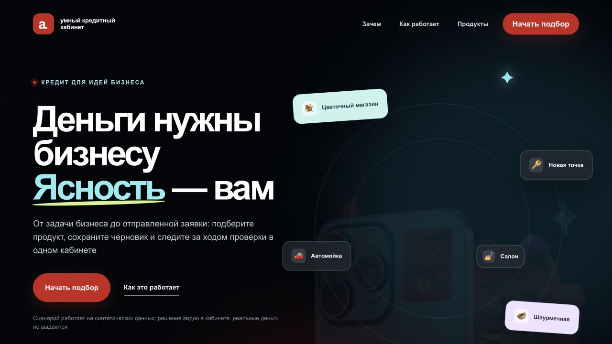
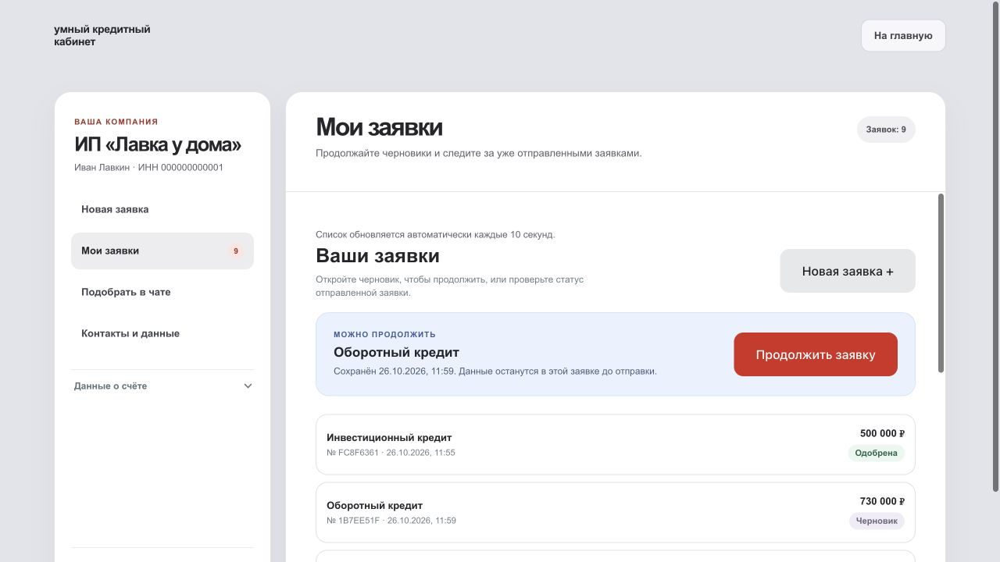
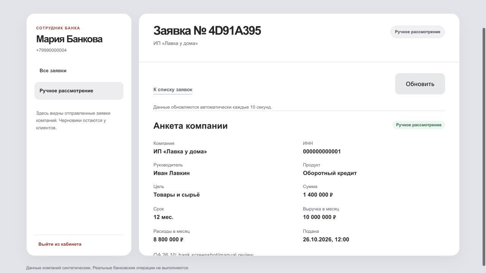

# Умный кредитный кабинет — общий запуск

Этот репозиторий связывает три отдельных проекта через Git submodules:

| Модуль | Репозиторий | Что запускается |
| --- | --- | --- |
| `frontend/` | [smart-credit-frontend](https://github.com/Tilekbeki/smart-credit-frontend) | React и Nginx |
| `backend/` | [smart-credit-backend](https://github.com/Tilekbeki/smart-credit-backend) | Go API и worker |
| `scoring/` | [smart-credit-scoring](https://github.com/Tilekbeki/smart-credit-scoring) | Python `logreg_v1` |

Общий Compose также поднимает PostgreSQL и однократно применяет миграции. Указатели submodules фиксируют проверенные вместе коммиты; изменение в дочернем репозитории само по себе не меняет эту сборку.

## Запуск одной командой

Нужны Docker Engine и Docker Compose, а также доступ ко всем четырём приватным репозиториям.

```sh
git clone --recurse-submodules https://github.com/Tilekbeki/smart-credit.git
cd smart-credit
docker compose up --build -d --wait --wait-timeout 300
```

Для существующего checkout обновите общий репозиторий и зафиксированные версии
модулей, затем пересоберите стек:

```sh
git pull --ff-only
git submodule update --init --recursive
docker compose up --build -d --wait --wait-timeout 300
```

Команды выполняются из корня `smart-credit`. `--remote` для submodules не нужен:
обычный update берёт совместимые коммиты, сохранённые в общем репозитории. При
локальных изменениях сначала сохраните свою работу; не сбрасывайте её ради обновления.

После запуска откройте [главную](http://127.0.0.1:8081) или
[кабинет](http://127.0.0.1:8081/cabinet). Отдельный `.env` для локального старта
не обязателен. Если порт занят, выберите другой. В Bash:

```sh
FRONTEND_PORT=8082 docker compose up --build -d --wait --wait-timeout 300
```

В Windows PowerShell:

```powershell
$env:FRONTEND_PORT='8082'
docker compose up --build -d --wait --wait-timeout 300
```

Сайт будет доступен на `http://127.0.0.1:8082`. Go API, scoring и PostgreSQL
не публикуют порты на компьютере: браузер обращается к API через frontend `/api/`.

### Основные переменные окружения

Значения ниже задаются при запуске Compose; `.env` не обязателен.

| Переменная | Значение по умолчанию | Назначение |
| --- | --- | --- |
| `FRONTEND_PORT` | `8081` | Локальный порт веб-продукта |
| `DEMO_OTP_CODE` | `1221` | Учебный код входа; реальные SMS не отправляются |
| `MAX_ACTIVE_DRAFTS_PER_CLIENT` | `20` | Лимит активных черновиков |
| `SCORING_TIMEOUT` | `5s` | Тайм-аут вызова Python scoring |
| `POSTGRES_DB`, `POSTGRES_USER`, `POSTGRES_PASSWORD` | `smart_credit`, `smart_credit`, `smart-credit-demo-local-only` | Локальная учебная БД; пароль по умолчанию не предназначен для внешней публикации |
| `JWT_SECRET` | пусто | Если не задан, backend создаёт секрет в приватном Docker volume |

Полный состав контейнеров и переменных приведён в [`compose.yaml`](compose.yaml).

### Тестовые входы

**Клиенты**

| Номер | Профиль | Что проверить |
| --- | --- | --- |
| `+79990000001` | Иван Лавкин, ИП «Лавка у дома» | Заявка клиента с учебными подтверждёнными оборотами |
| `+79990000002` | ООО «Мастерская Север» | Заявка клиента без счёта в Альфе; для отправки потребуется выписка |
| `+79990000003` | ООО «Точка вкуса» | Дополнительный клиентский профиль |

**Сотрудник банка**

| Номер | Профиль | Что проверить |
| --- | --- | --- |
| `+79990000004` | Мария Банкова | Очередь заявок, оценка и ручное решение |

Для всех профилей код **`1221`**. Настоящие SMS не отправляются. Нажмите
«Уже есть кабинет? Войти» в чате и введите номер. Для другого профиля сначала
выйдите: JWT запоминается браузером, обновление страницы сохраняет текущий вход.
Гость может получить рекомендацию в чате без входа. После авторизации доступны
обычная форма новой заявки и отдельный подбор в чате.

#### Краткий сценарий для жюри: ручное рассмотрение

1. Войдите как Иван Лавкин (`+79990000001`) и откройте **новую заявку**.
   Выберите оборотный кредит и цель «Товары и сырьё». Укажите сумму
   **1 400 000 ₽**, срок **12 месяцев**, среднемесячную выручку **10 000 000 ₽**
   и расходы **8 800 000 ₽**. Заполните остальные обязательные поля и отправьте
   заявку. После обработки клиент увидит статус «Ожидает рассмотрения»
   (`manual_review`): окончательного решения и предложения на этом этапе ещё нет.
2. Выйдите из аккаунта клиента и войдите как Мария Банкова (`+79990000004`).
   Откройте вкладку «Ручное рассмотрение», найдите заявку ИП «Лавка у дома» и
   изучите её карточку и оценку. Выберите «Одобрить», «Другие условия» или
   «Отказать», заполните внутренний комментарий и при необходимости пояснение
   клиенту. Нажмите «Проверить решение», затем «Подтвердить решение».
3. Снова войдите как Иван Лавкин. В той же заявке проверьте итоговое решение и
   публичное объяснение. Если создано предложение, его можно принять или
   отклонить. Принятие означает учебное подтверждение условий, без реальной
   подписи и выдачи денег.

Для смены роли используйте «Выйти из кабинета» перед следующим входом. Этот
сценарий проходит целиком в веб-продукте; Postman не требуется.

Общая сборка включает контакты с проверкой версий, удаление черновиков,
подробности скоринга и публичные пояснения решений. По умолчанию разрешено 20 активных
черновиков на клиента; параметр `MAX_ACTIVE_DRAFTS_PER_CLIENT` меняет этот предел.

`frontend` ждёт готовности Go API; API ждёт PostgreSQL, успешного завершения миграций и здорового scoring. Статус сервисов показывает `docker compose ps --all`. `migrate` должен завершиться с кодом 0, а остальные сервисы — быть healthy. Публично открыт только адрес фронтенда; Nginx пересылает `/api/` на Go API внутри сети Compose, поэтому отдельный CORS не нужен.

## Проверка связки

В другом терминале выполните. Для Linux/macOS:

```sh
python3 scripts/smoke.py
```

Для Windows PowerShell:

```powershell
$env:PYTHONIOENCODING='utf-8'
python scripts/smoke.py
```

Если выбран порт `8082`, перед smoke задайте `SMART_CREDIT_URL`: в Bash —
`export SMART_CREDIT_URL=http://127.0.0.1:8082`, в PowerShell —
`$env:SMART_CREDIT_URL='http://127.0.0.1:8082'`.

Smoke-сценарий обращается к API через публичный адрес фронтенда: проверяет вход и решение для компании с подтверждёнными оборотами, а затем путь компании без такого источника — требование выписки, её загрузку и последующую отправку заявки. Он также проверяет участие scoring и сохранение результата после повторного входа. Каждый запуск создаёт новые тестовые заявки. Для другого тестового кода задайте одинаковое значение `DEMO_OTP_CODE` в Compose и `SMART_CREDIT_OTP_CODE` для smoke-скрипта.

### Диагностика и остановка

```sh
docker compose ps --all
docker compose logs --tail=100 frontend backend scoring postgres migrate
docker compose exec -T backend wget -qO- http://127.0.0.1:8080/ready
docker compose exec -T scoring python -c "import urllib.request; print(urllib.request.urlopen('http://127.0.0.1:8001/health').read().decode())"
docker compose down
```

Тестовые заявки, документы и локальный JWT-секрет сохраняются в Docker volumes
между запусками. Обычная остановка — `down` без удаления volumes.

Если submodules пустые, выполните `git submodule update --init --recursive`.
При ошибке доступа проверьте, что GitHub-аккаунт имеет доступ к общему и трём
дочерним приватным репозиториям. Зависание запуска разбирайте по `ps --all` и
логам: `migrate` должен завершиться успешно, PostgreSQL и scoring — пройти healthcheck.
Код входа и адрес для smoke должны совпадать с параметрами запущенного Compose.

Вся информация демонстрационная. `signed` означает подтверждение условий в прототипе; реальный договор, выдача денег и банковские операции здесь не выполняются. Scoring даёт предварительную рекомендацию; окончательное решение и статус сохраняет Go backend.

## Зачем устроен такой путь

Предпринимателю важно получить предварительный подбор без лишнего обязательства,
сохранить введённые сведения и увидеть понятный результат по той же заявке. Банку
нужны проверяемые источники данных, последовательные статусы, разграничение
ролей и возможность ручного рассмотрения. Поэтому подбор отделён от кредитного
решения, а рекомендация Python — от окончательной политики Go. Основание этих
решений — анализ открытых банковских сценариев в
[UX-бенчмарке](frontend/docs/UX_BENCHMARK.md) и
[карте путей клиента](frontend/docs/ACCOUNT_JOURNEYS.md). Интервью с реальными
клиентами или сотрудниками банка не проводились; результаты CustDev не заявляются.

## Документация для проверки

- [Архитектура и границы компонентов](backend/docs/architecture.md),
  [модель данных и ER-схема](backend/docs/data-model.md),
  [диаграмма состояний и кредитная политика](backend/docs/credit-process.md).
- [Описание API для frontend](backend/api/FRONTEND_INTEGRATION.md),
  [OpenAPI](backend/api/openapi.yaml),
  [Postman Collection](backend/api/postman/smart-credit.postman_collection.json).
- [Тестовые сценарии веб-продукта](docs/TEST_SCENARIOS.md),
  [дополнительные сценарии проверки API](backend/docs/JURY_DEMO_GUIDE.md),
  [отчёт о браузерных проходах](frontend/docs/QA_REPORT_2026-10-26.md),
  [покрытие кейса](frontend/docs/CASE_COVERAGE.md).
- [Сторонние компоненты, модель и синтетические данные](THIRD_PARTY_NOTICES).

Основной показ выполняется в веб-продукте по этой инструкции. Руководство backend
описывает **отдельный** API-стенд с Postman и своим OTP-кодом `1234`; его команды
и учётные данные не нужны для общего Docker Compose, где используется `1221`.

## Скриншоты

Экраны настоящего локального frontend с синтетическими данными, 26.10.2026.

### Главная



### Диалог с котом


### Кабинет клиента



### Кабинет банка



## Что проверено

[Подробный QA-отчёт](frontend/docs/QA_REPORT_2026-10-26.md):
все четыре профиля, шесть целей, гостевой и авторизованный чат, заявки со счётом
и без, документы, ручные решения банка, ответы клиента, конфликты и лимит.
Исправлены доступность отправки при неразрешённом конфликте и противоречивое
сообщение при технической остановке. Проходят 50 unit-тестов frontend,
47 проверок реального API и оба сквозных smoke-сценария.

Исходный QA-прогон проходил без Docker. Дополнительно 26.10.2026 общий Compose
собран локально из закреплённых submodule-коммитов: frontend, backend, scoring и
PostgreSQL получили `healthy`, миграции завершились с кодом 0. Оба сценария
`scripts/smoke.py` прошли через frontend `/api/` → Go → Python.
После исчерпания попыток обработки backend
пока не предоставляет API перезапуска: это ограничение описано в QA-отчёте.

## Работа с модулями

Код каждого модуля меняется и тестируется в его собственном репозитории. После публикации нужного коммита обновите соответствующий submodule в общем репозитории и зафиксируйте новый указатель. CI дочерних репозиториев запускается независимо; CI этого репозитория проверяет ссылки на модули и синтаксис Compose при изменении общей конфигурации.
